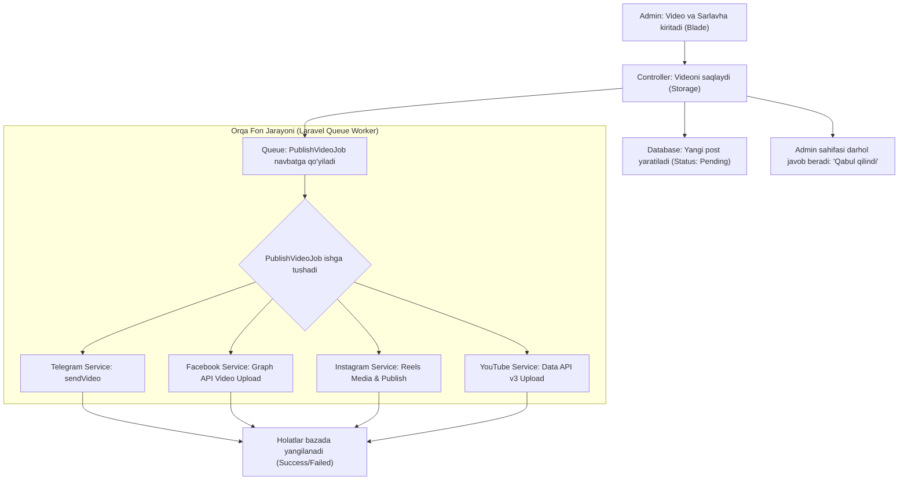

# Laravel Social Publisher: Video Yuklash va Ijtimoiy Tarmoqlarga Tarqatish Qo‘llanmasi

Ushbu qo‘llanma **Laravel (Blade)** asosidagi veb-saytingizga yangi bo‘lim qo‘shish, video va uning sarlavhasini kiritganda uni bir vaqtning o‘zida **saytga, Telegram, YouTube, Facebook va Instagram** tarmoqlariga sayt tezligiga ziyon yetkazmasdan avtomatik yuklash tizimini yaratish uchun tayyorlandi. *(TikTok hisobga olinmagan).*

---

## 1. Tizim Arxitekturasi va Ishlash Prinsipi

Saytning asosiy ishlash tezligiga zarracha ta'sir qilmaslik uchun tizim **Asinxron Navbat (Laravel Queue & Jobs)** asosida ishlaydi.



> **Nega bu usul saytni sekinlashtirmaydi?**
> Admin «Yuklash» tugmasini bosganda, sahifa qotib qolmaydi. Laravel faylni serverga 1–2 soniyada saqlaydi va adminga darhol javob qaytaradi. Barcha tarmoqlarga video yuklash orqa fonda (`php artisan queue:work`) mustaqil bajariladi.

---

## 2. Platformalar va API Sozlamalari

Har bir tarmoqqa avtomatik yuklash uchun rasmiy API kalitlari kerak bo‘ladi:

### 2.1. Telegram (Eng oson)
- **Qanday ulanadi:** `@BotFather` orqali yangi bot ochiladi va **Bot Token** olinadi.
- **Kanal:** Bot kanalingizga a'zo qilinadi va unga **Administrator** (Post yozish ruxsati) beriladi.
- **Parametrlar:** 
  - `TELEGRAM_BOT_TOKEN=...`
  - `TELEGRAM_CHAT_ID=@kanalingiz_username` yoki `-100...`

---

### 2.2. Facebook & Instagram (Meta Graph API)
Instagram va Facebook bitta kompaniya (Meta) bo‘lgani uchun bir xil boshqaruv panelidan sozlanadi:

1. **Meta Developer:** `developers.facebook.com` saytida ro‘yxatdan o‘tib, yangi **App** yaratiladi.
2. **Facebook Page:** Sahifangiz uchun doimiy **Page Access Token** olinadi (`pages_manage_posts`, `pages_read_engagement`).
3. **Instagram:** 
   - Instagram akkaunt **Professional (Creator yoki Business)** holatiga o‘tkazilgan bo‘lishi kerak.
   - Instagram akkaunt Facebook sahifasiga bog‘lanadi.
   - Meta orqali `INSTAGRAM_ACCOUNT_ID` aniqlanadi.
4. **Instagram Reels talabi:** Instagram video faylni to‘g‘ridan-to‘g‘ri qabul qilmaydi, balki serveringizdagi **ochiq HTTPS havola (URL)** orqali yuklab oladi. Laravel orqali videoga vaqtinchalik public link beriladi.

---

### 2.3. YouTube (Google Cloud Console)
1. **Google Cloud Console:** `console.cloud.google.com` ga kiriladi.
2. Yangi loyiha yaratilib, **YouTube Data API v3** yoqiladi (Enable).
3. **OAuth 2.0 Client ID** yaratiladi va bir marta ruxsat olinib, uzoq muddatli **Refresh Token** saqlab olinadi.
4. Ushbu refresh token orqali Laravel har doim avtomatik ravishda yangi access token olib, videoni kanalingizga yuklaydi.

---

## 3. Ma'lumotlar Bazasi Strukturasi (Migration)

Saytda yuklangan videolarni va har bir tarmoqdagi holatini kuzatish uchun bitta asosiy jadval yaratiladi:

```php
Schema::create('video_posts', function (Blueprint $table) {
    $table->id();
    $table->string('title');
    $table->text('description')->nullable();
    $table->string('video_path');
    $table->string('slug')->unique();
    
    // Tarmoqlarga yuborish bayroqlari
    $table->boolean('send_to_telegram')->default(true);
    $table->boolean('send_to_youtube')->default(true);
    $table->boolean('send_to_facebook')->default(true);
    $table->boolean('send_to_instagram')->default(true);

    // Yuklanish holatlari (pending, success, failed)
    $table->string('telegram_status')->default('pending');
    $table->string('youtube_status')->default('pending');
    $table->string('facebook_status')->default('pending');
    $table->string('instagram_status')->default('pending');

    $table->text('error_log')->nullable();
    $table->timestamps();
});
```

---

## 4. Dasturiy Qismlar (Laravel Kod Tuzilmasi)

### 4.1. `.env` Sozlamalari
```env
QUEUE_CONNECTION=database

# Telegram
TELEGRAM_BOT_TOKEN=123456789:ABCdef...
TELEGRAM_CHAT_ID=@mening_kanalim

# Facebook & Instagram
META_PAGE_ACCESS_TOKEN=EAAG...
FACEBOOK_PAGE_ID=1092837465...
INSTAGRAM_ACCOUNT_ID=178414...

# YouTube
GOOGLE_CLIENT_ID=...apps.googleusercontent.com
GOOGLE_CLIENT_SECRET=...
GOOGLE_REFRESH_TOKEN=1//04...
```

---

### 4.2. Blade Formasi (`resources/views/admin/publisher/create.blade.php`)
Admin panelingizdagi video yuklash formasi:

```html
<form action="{{ route('admin.publisher.store') }}" method="POST" enctype="multipart/form-data">
    @csrf

    <div class="form-group mb-3">
        <label>Video Sarlavhasi:</label>
        <input type="text" name="title" class="form-control" required placeholder="Video nomini kiriting...">
    </div>

    <div class="form-group mb-3">
        <label>Tavsif / Matn (Description):</label>
        <textarea name="description" class="form-control" rows="4" placeholder="Post matni va #heshteglar..."></textarea>
    </div>

    <div class="form-group mb-3">
        <label>Video Fayl (.mp4):</label>
        <input type="file" name="video" class="form-control" accept="video/mp4,video/quicktime" required>
    </div>

    <div class="form-group mb-3">
        <label>Tarmoqlarni tanlang:</label><br>
        <label><input type="checkbox" name="platforms[telegram]" checked> Telegram</label> &nbsp;
        <label><input type="checkbox" name="platforms[youtube]" checked> YouTube</label> &nbsp;
        <label><input type="checkbox" name="platforms[facebook]" checked> Facebook</label> &nbsp;
        <label><input type="checkbox" name="platforms[instagram]" checked> Instagram</label>
    </div>

    <button type="submit" class="btn btn-primary">Yuklash va Tarqatish</button>
</form>
```

---

### 4.3. Controller (`VideoPublisherController.php`)
```php
namespace App\Http\Controllers\Admin;

use App\Http\Controllers\Controller;
use Illuminate\Http\Request;
use App\Models\VideoPost;
use App\Jobs\PublishVideoToSocialMediaJob;
use Illuminate\Support\Str;

class VideoPublisherController extends Controller
{
    public function store(Request $request)
    {
        $request->validate([
            'title' => 'required|string|max:255',
            'video' => 'required|mimes:mp4,mov|max:500000', // 500MB gacha
        ]);

        // 1. Videoni diskka saqlash
        $videoPath = $request->file('video')->store('videos', 'public');

        // 2. Bazaga yozish
        $platforms = $request->input('platforms', []);
        $post = VideoPost::create([
            'title' => $request->title,
            'description' => $request->description,
            'video_path' => $videoPath,
            'slug' => Str::slug($request->title) . '-' . time(),
            'send_to_telegram' => isset($platforms['telegram']),
            'send_to_youtube' => isset($platforms['youtube']),
            'send_to_facebook' => isset($platforms['facebook']),
            'send_to_instagram' => isset($platforms['instagram']),
        ]);

        // 3. Orqa fon navbatiga jo'natish (Sayt kutib o'tirmaydi)
        PublishVideoToSocialMediaJob::dispatch($post);

        return redirect()->back()->with('success', 'Video qabul qilindi va orqa fonda tarmoqlarga yuklanmoqda!');
    }
}
```

---

### 4.4. Alohida Servislar (Services)

Har bir tarmoq uchun toza va alohida service klasslar tuziladi:

1. **`App\Services\Social\TelegramPublisherService`**
   - Telegram Bot API `sendVideo` orqali videoni sarlavhasi bilan kanalga chiqaradi.
2. **`App\Services\Social\FacebookPublisherService`**
   - Meta Graph API `/{page-id}/videos` orqali sahifaga yuklaydi.
3. **`App\Services\Social\InstagramPublisherService`**
   - Serverdagi ochiq URL orqali `media_type=REELS` yaratadi va `media_publish` orqali e'lon qiladi.
4. **`App\Services\Social\YouTubePublisherService`**
   - `google/apiclient` orqali videoni YouTube Data API v3 bilan yuklaydi.

---

### 4.5. Background Job (`PublishVideoToSocialMediaJob.php`)

```php
namespace App\Jobs;

use App\Models\VideoPost;
use App\Services\Social\TelegramPublisherService;
use App\Services\Social\FacebookPublisherService;
use App\Services\Social\InstagramPublisherService;
use App\Services\Social\YouTubePublisherService;
use Illuminate\Bus\Queueable;
use Illuminate\Contracts\Queue\ShouldQueue;
use Illuminate\Foundation\Bus\Dispatchable;
use Illuminate\Queue\InteractsWithQueue;
use Illuminate\Queue\SerializesModels;

class PublishVideoToSocialMediaJob implements ShouldQueue
{
    use Dispatchable, InteractsWithQueue, Queueable, SerializesModels;

    public $timeout = 600; // 10 daqiqa (katta videolar uchun)
    protected $post;

    public function __construct(VideoPost $post)
    {
        $this->post = $post;
    }

    public function handle(
        TelegramPublisherService $telegram,
        FacebookPublisherService $facebook,
        InstagramPublisherService $instagram,
        YouTubePublisherService $youtube
    ) {
        $videoFullPath = storage_path('app/public/' . $this->post->video_path);

        // 1. Telegram
        if ($this->post->send_to_telegram && $this->post->telegram_status !== 'success') {
            try {
                $telegram->send($this->post, $videoFullPath);
                $this->post->update(['telegram_status' => 'success']);
            } catch (\Exception $e) {
                $this->post->update(['telegram_status' => 'failed', 'error_log' => $e->getMessage()]);
            }
        }

        // 2. Facebook
        if ($this->post->send_to_facebook && $this->post->facebook_status !== 'success') {
            try {
                $facebook->send($this->post, $videoFullPath);
                $this->post->update(['facebook_status' => 'success']);
            } catch (\Exception $e) {
                $this->post->update(['facebook_status' => 'failed', 'error_log' => $e->getMessage()]);
            }
        }

        // 3. Instagram
        if ($this->post->send_to_instagram && $this->post->instagram_status !== 'success') {
            try {
                $instagram->send($this->post);
                $this->post->update(['instagram_status' => 'success']);
            } catch (\Exception $e) {
                $this->post->update(['instagram_status' => 'failed', 'error_log' => $e->getMessage()]);
            }
        }

        // 4. YouTube
        if ($this->post->send_to_youtube && $this->post->youtube_status !== 'success') {
            try {
                $youtube->send($this->post, $videoFullPath);
                $this->post->update(['youtube_status' => 'success']);
            } catch (\Exception $e) {
                $this->post->update(['youtube_status' => 'failed', 'error_log' => $e->getMessage()]);
            }
        }
    }
}
```

---

## 5. Server va Navbatni Sozlash (Production)

Navbat to‘xtab qolmasdan doim ishlab turishi uchun Linux serverda **Supervisor** ishlatiladi:

Fayl: `/etc/supervisor/conf.d/laravel-worker.conf`
```ini
[program:laravel-worker]
process_name=%(program_name)s_%(process_num)02d
command=php /var/www/saytingiz/artisan queue:work --sleep=3 --tries=3 --max-time=3600
autostart=true
autorestart=true
user=www-data
numprocs=2
redirect_stderr=true
stdout_logfile=/var/www/saytingiz/storage/logs/worker.log
```

---

## 6. Xulosa

Ushbu arxitektura yordamida:
1. Siz Blade formasi orqali videoni bir marta yuklaysiz.
2. Saytingizga yangi sahifa bo‘lib tushadi.
3. Telegram, YouTube, Facebook va Instagramga orqa fonda avtomatik joylanadi.
4. Saytingiz foydalanuvchilariga hech qanday sekinlashish yoki qotish bo‘lmaydi.
